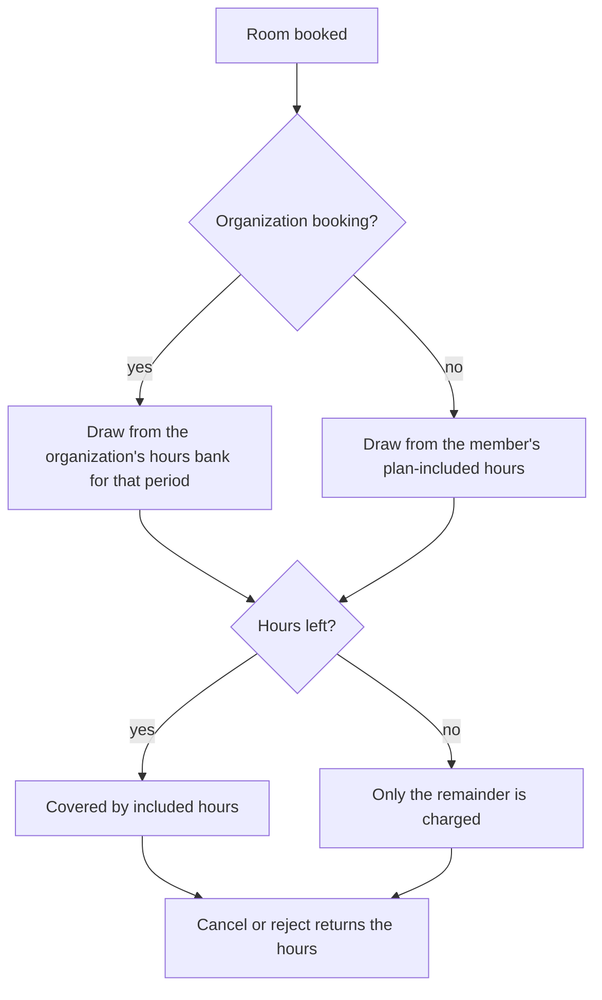

# Take room bookings

**You will finish with** a bookable room, a membership plan that includes booking hours, a member booking that uses those hours before any charge, and an organization booking that draws from the organization's own hours bank.

**You need** the **Bookings** area switched on. For plan-included hours you also need **Membership** switched on. For organization bookings you need an organization linked to your space and the **Organization bookings** feature on (**Settings**, **Areas**, **Features**). A Space Manager account is simplest.

## Part 1: Create a bookable room

1. Open **Bookings**, then **Spaces**, and press **New space**.

2. Fill in the name, type, capacity, location and description. For machine time, choose **Machine time** and pick the machine; its type's training rules then apply automatically.

3. Set the booking price (leave it free to start), whether it is listed publicly, and when it is available.

4. Press **Create space**.

   **Expected:** the room opens with the tabs **Requests**, **Calendar**, **Issues**, **Photos** and **Settings**.

5. In **Settings**, upload a **Booking listing photo**. This is the picture shown on the public booking page.

6. Decide whether bookings need approval. The room's label for members says either **Needs approval** or **Instant when available**.

   > **Note** Booking rules for the whole space, such as cut-offs and limits, belong to the Space Manager under **Settings**, **Areas**, **Bookings**.

## Part 2: Give a membership plan included hours

7. Open **Members**, then **Plans**, and press **Create plan**. Enter the name, amount, currency and how often it renews.

8. In the **Included hours** group of the form, set **Room booking hours per term**. If machines are also on, you will see **Machine time hours per term** too. Enter a whole number from 0 up to the limit shown; 0 means none. Press **Save plan**.

   **Expected:** the plan is saved. Without the Membership area there are no plans, so nothing is included and every booking is charged as usual.

9. Put a price on the room (step 3) if you have not, so you can see included hours at work.

## Part 3: Book as a member

10. In a private window, sign in as a member on that plan. Open **Book a makerspace** and pick the room.

11. Press **Choose a time**, set a start and end, then **Book this slot** (or **Submit booking request** if approval is needed).

    **Expected:** the confirmation shows no charge up to the hours left on the plan. A booking beyond the allowance charges only the remainder.

12. Open the member area and look for **Included hours** (it appears where the member dashboard shows what they have left).

    **Expected:** a line such as "2 h included · 6 h left this term", with a warning when it is nearly used. A rejected booking or an in-policy cancellation returns the hours.

13. In **Bookings** in the member area, open **My bookings** and press **View confirmation** to see the arrival QR and calendar links.

    > **Tip** Staff can scan that QR from 30 minutes before the start. Recording an arrival does not complete the booking and does not open any door.

## Part 4: Approve and manage requests

14. As staff, open **Bookings**, then **Requests**. Filter by **Awaiting review**, **Confirmed**, **Rejected**, **Cancelled** or **All**.

15. Press **Approve**, or **Reject with reason**. A reason is required, because the requester is told either way.

16. Open a booking for **Cancel**, **Complete** or **No-show**. Where staff reservation tools are on, you can also **Edit booking time**. Cut-offs still apply.

## Part 5: Book for an organization

An organization is a shared profile for a group, such as a school club. A platform administrator links it to your space; owners and governors then invite its people. The organization gets its own pool of hours at each space.

17. Open a room, press **New booking**, and in **Who is this booking for?** choose **Organization**.

    **Expected:** the form changes to **Book for an organization**. If no organization is linked yet, it says so. If the feature is off, it says organization bookings are unavailable.

18. Choose the **Organization**, then the **Contact**: a member of that organization who also belongs to your space. Set the start, end and an optional **Staff note**. Press **Create organization booking**.

    **Expected:** the booking is made for the contact, recorded against the organization, and no plan hours are drawn from the contact's membership.

19. Before creating it, look at the **Organization hours bank** card on the same form. It reads, for example, "6 h left of 10 h", and says bookings use these hours first and only the rest is charged.

20. Set the allowance. Under **Allowance (hours per period)** enter the hours, choose **Resets**: **Never (one pool)**, **Every calendar month** or **Every calendar year**, and press **Save allowance**.

21. To top up or take hours back, enter a number under **Grant or adjust (hours, negative to remove)**, add a **Reason**, and press **Add to ledger**.

    **Expected:** the **Ledger** below lists each draw, return, grant and adjustment. Rows are never edited or deleted. Hours do not roll over between periods.

    > **Warning** With no allowance set, the card says bookings for this organization use no included hours, so everything is charged.

22. Cancel the organization booking.

    **Expected:** the hours go back into the bank and the ledger shows the return.

23. As an organization owner or governor, open the staff console's **Organizations** tab, pick the organization and read **Included hours**. They can read the balance and ledger but not change it.

## What you have now

Bookable rooms with fair, visible allowances. Next steps: put a charge on the room and see how it is collected in [Take payments](take-payments.md); give helpers access to a single room via **Settings**, **Staff access** in the room; and read the [Bookings Manager guide](../user-guides/bookings-manager.md). Reference: [Bookings module](../MODULES-WORKSHOPS.md#bookings).
