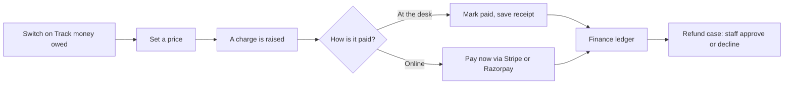

# Take payments

**You will finish with** a charge raised and tracked, an offline payment recorded with a receipt, an online provider connected, and one refund case decided.

**You need** a Space Manager account and at least one area that can raise a charge, such as Bookings, Events, Machines, Membership or Inventory loans. For the online steps you also need your own Stripe or Razorpay account.

> **Note** Space Works keeps two things apart. **Tracking money owed** records every debt and every receipt, and works with no payment provider at all. **Online payments** is a separate, optional add-on that lets people pay by card. You can run a space for years on tracking and desk payments alone.

## Part 1: Switch on money tracking

1. Open **Settings**, then **Areas**, **Features**. Find **Track money owed** and tick it. This is the master switch: with it off the space charges for nothing.

2. Tick the finer switches for the areas you charge for, for example **Track booking charges**, **Track event charges**, **Track machine charges**, **Track membership charges** and **Track loan charges**. A switch whose area is off tells you to turn the area on first.

   **Expected:** from now on, anything priced in those areas raises a charge that members can see under **Payments** in their member area.

## Part 2: Set a price

3. Open **Settings**, then **Money**, then **Pricing**.

4. Choose an area (**Inventory**, **Machines**, **Bookings**, **Events** or **Membership**) and choose **Free** or **Paid**. Set the rates, caps and grace periods.

5. Check the **Worked example** under the form. It shows what a typical member would pay. Save.

   **Expected:** with nothing configured, everything new is free. Individual items can inherit the price list, be free, or have their own price.

6. Optional: under **Member discounts** press **New discount**, name it, choose who gets it (all members, one plan's members or one member), the kind and its dates. Only the single best discount applies.

7. Under **Money**, **Tax**, choose **No tax**, **One named tax** or **India GST** and save. Tax applies to charges raised from then on.

   > **Note** Money settings such as tax, pricing, billing and payments belong to the Space Manager alone and cannot be handed to anyone else.

## Part 3: Collect in person and record a receipt

8. Raise a test charge: book a priced room as a member, or give a loan a fee. See [Take room bookings](room-bookings.md).

9. As staff open **Payments**. Filter by **To collect**.

   **Expected:** your charge is listed with its status: to collect, paid online, paid in person, waived or cancelled.

10. On the charge's row press **Mark paid**. For many at once, select them and press **Mark paid in person**.

11. In **Record payment** choose the method (cash, UPI, bank transfer, card machine, cheque or other), add a reference and the date received, then **Save receipt**.

    **Expected:** the charge becomes paid and a receipt is kept. You are recording what happened; no money moves inside Space Works.

12. Made a mistake? Press **Correct receipt**. It adds a correction rather than altering the original, so the history stays honest.

13. Open **Finance** to see the entry. **Income and spending**, **Expenses and receipts** and **Event money** break the figures down by month and area. Press **Record money**, then **Record an expense** to add a cost with a receipt photo.

    > **Tip** **Waive** cancels a charge that should not be paid. **Pay link** creates a link that pays one charge, even for someone without an account; links expire after 14 days by default and a new link cancels the old one, where pay links are on.

14. To require a second pair of eyes, turn on the **two-person check**: a recorded receipt then waits under **Finance**, **Offline payments** until a different person with the payments action presses **Confirm** or **Reject**. Nobody confirms their own receipt.

## Part 4: Connect Stripe or Razorpay

15. Open **Settings**, then **Areas & add-ons**, and switch on **Online payments** (shown as Payments).

    **Expected:** the add-on is installed. On a hosted platform with a usage limit on it, the platform administrator installs it instead.

16. Open **Settings**, then **Money**, then **Payments & billing**. Under **Online payments**, choose the **Payment provider**: **Stripe** or **Razorpay**.

17. Paste the credentials. For Stripe: **Stripe publishable key**, **Stripe secret key** and **Stripe webhook secret**. For Razorpay: **Razorpay key ID**, **Razorpay API key secret** and **Razorpay webhook secret**. Set the **Default payment currency** (a three-letter code).

    **Expected:** saved secrets are encrypted and shown only as "set"; they are never displayed again. Changing credentials asks you to verify your identity again.

18. Copy the **Stripe webhook URL** or **Razorpay webhook URL** shown under the fields and add it as a webhook in your provider's dashboard, then paste the signing secret into the webhook field here.

    > **Warning** Settle or close any pending online collections before switching provider.

19. Press save. The status pill shows **Own credentials**.

    > **Note** On a hosted platform with Stripe Connect, a **Connect Stripe** button appears instead of pasting your own keys. Your own credentials take precedence if both exist.

20. Test it: as a member open **Payments** and press **Pay now** on a small charge.

    **Expected:** the provider's checkout opens; after paying, the charge shows as paid online and a receipt is available under **Payment documents**.

## Part 5: Decide a refund

Every refund in Space Works is a case a person decides. Nothing goes back automatically.

21. As a member, open **Payments**, press **Request refund** on a paid charge, give a reason and press **Send request**. Staff-side events such as cancelling a paid booking or event open cases on their own.

22. As staff open **Refunds** and filter by **To decide**. Open the case and read why it was opened.

23. Choose **Approve** or **Decline**. Set the **Amount to refund** and a **Note to the member**, then confirm.

    **Expected:** a card payment is refunded through the provider. If the provider refuses, the case moves to **Provider refused** for you to retry or decline. A cash payment is refunded by hand and recorded.

    > **Tip** When you lower a price after people have paid, Space Works lists each affected payment in a **Lower this price?** dialog and opens a refund case for the difference. A price rise never charges anyone more.

## What you have now

A money trail from raise to settle to refund that works with or without a card provider. Continue with [Tax, receipts and disputes](../payment-documents.md), the [Finance reference](../payment-billing.md) and the [Space Manager guide](../user-guides/space-manager.md).
