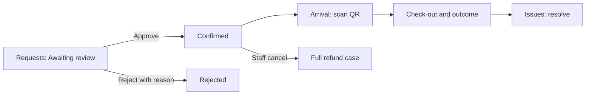

# Bookings Manager

The Booking Manager runs rooms, workbenches and other bookable resources, and decides who books them. You manage reservations for every resource in the space. Booking rules for the whole space, such as cut-offs and limits, belong to the Space Manager unless they give you control of **Booking settings**.

## Your daily loop

## The screens you see

**Bookings** with **Spaces** and **Requests**. Inside a resource: **Requests**, **Calendar**, **Issues**, **Photos**, **Settings**, and where the features are on **Arrivals**, **Pass designer**, **Website**, **Broadcasts**, **Analytics**.

## How do I create a bookable room?

1. **Bookings**, **Spaces**, **New space**.
2. Fill in name, type, capacity, location and description. For machine time choose **Machine time** and pick the machine; its type's training rules apply automatically.
3. Set the booking price, public listing and availability. **Create space**.
4. In **Settings** upload a **Booking listing photo**. **Clone resource** copies a room; **Deactivate space** hides it and stops new bookings.

## How do I decide requests?

1. **Bookings**, **Requests**. Filter **Awaiting review**, **Confirmed**, **Rejected**, **Cancelled** or **All**.
2. **Approve**, or **Reject with reason**. A reason is required because the requester is told either way.
3. Inside a space you can also **Cancel**, **Complete** or mark **No-show**, with a reason.

Where staff reservation tools are on, use **Edit note and answers**, **Edit booking time** and **Undo cancellation** (recent cancellations only). Cut-offs still apply and no money moves.

## How do I book for someone?

- **For a member:** open the space, **New booking**, **Book for a member**; choose the member, start and end; tick the repeat option for weekly repeats (2 to 52); add a staff note and, if needed, a certification override reason; **Create booking**. The member needs an active membership and a current waiver; each repeat is checked on its own.
- **For an organization:** **New booking**, **Who is this booking for?**, **Organization**. Choose the organization and a contact who is a member of both. The booking is recorded against the organization and draws from its **hours bank** first; only the rest is charged and cancelling returns the hours. See [Take room bookings](../tutorials/room-bookings.md).

## How do I handle money on bookings?

A priced booking raises a charge when confirmed. On a booking's row **Mark offline** records a payment taken at the desk and **Waive** cancels the charge. A booking staff cancel owes a full refund, decided under **Refunds**.

## How do I check people in?

1. Open the space, **Arrivals**, **QR arrival**. Scan or paste the booker's QR; staff can scan from 30 minutes before the start.
2. Check the details, **Confirm arrival**, then **Scan another**. **Reverse recorded arrival** fixes a mistake. At the end **Record check-out**.
3. Recording an arrival does not complete the booking and does not open any doors.
4. **Pass designer:** choose paper, orientation, card size and fields (name, resource, window, reference), **Download sample PDF**, save the layout. Passes never show custom answers.

## How do I give a helper access to one room?

Open the space, **Settings**, **Staff access**: enter their email, tick what they may do (edit details, manage reservations, check in, publish the page), **Invite staff**. The link is shown once; tick **Email the invitation link** to send it too. The helper accepts and works from **Assigned resources**. Invitations last seven days and never include pricing, rules or money.

## How do I publish and communicate?

- **Website:** **Add section**, **Save content**, check **Private preview**, **Release website**. For another site copy the snippet under **Sharing**, **Embed card**; the Space Manager must allow that site's address first.
- **Broadcasts:** write a subject and message, choose bookings by date and status, **Save draft**, **Send broadcast**. Sent emails cannot be recalled.

## How do I keep rooms in good order?

- **Issues** lists problems members flagged; **Resolve**, **Mark resolved**.
- Room maintenance: **Repairs**, **Maintenance**, add a **Room schedule**. Room repairs: **New repair job**. **In or out of service** closes a room with **Block new bookings** or **Only warn**; affected bookers are emailed and you cancel with a full refund or keep each booking.
- **Analytics:** pick a date range and download **Utilization CSV**, **Reservation CSV**, **Custom answers CSV** or **Utilization PDF**. Arrival counts show who was scanned in, not actual use. Analytics also needs the reports add-on and audit access.

## What can I not do?

Change the space's booking rules (without a grant), or pricing and tax. Helpers you invite never get pricing, rules or money.

## Related

[Tutorial: Take room bookings](../tutorials/room-bookings.md) · [Bookings module reference](../MODULES-WORKSHOPS.md#bookings)
