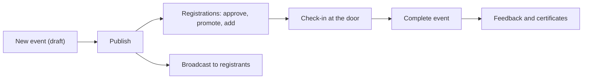

# Event Manager

The Event Manager runs events: workshops, talks, series and, where switched on, hackathons. You hold the events action, so you manage events in the space. People helping with just one event can be given narrower access (see **Event staff** below).

## Your daily loop

## The screens you see

**Events** (with **Series**), **Organized events** when an organization runs events through your space, **Assigned resources** for events you are only a helper on, **Finance** for your events' money, and **Reports**. Inside an event: **Overview**, **Registrations**, **Check-in**, **More** (with **Tickets & invites**, **Speakers**, **Feedback**, **Broadcasts**, **Analytics**, **Website**, **Team**, **Settings**, and programme sections where those features are on).

## How do I create and publish an event?

1. **Events**, **New event**, fill in the form (a preview shows the result), **Create event**. It starts as a draft.
2. Open it, **More**, **Settings**, **Publishing**: answer who can see it, who can find it and how people attend.
3. Under **Settings**, **Event photo**, upload a **Public event image** (wide works best).
4. Press **Publish**.

**Complete event** after it ends, or **Cancel event**: cancelling emails everyone registered and closes registration.

For repeating events, **Series**, **New series**: first date, repeat rule, weekdays, prices, **Create series**, **Publish series**. **Edit future occurrences**, **Extend now**, **Complete series** and **Cancel series** adjust it.

Walkthrough: [Run your first event](../tutorials/first-event.md).

## How do I manage tickets?

Under **More**, **Tickets & invites**:

- **Ticket types:** name, price, audience, capacity (0 is unlimited), sales window, **Add ticket type**. Price and audience lock once someone registers; a used ticket is **Deactivate**d, not deleted.
- **Promo codes:** percentage or fixed, optional custom code, uses, expiry. The code is shown once. They work only on fixed-price tickets.
- **Invitations:** one email or **Bulk email invitations** (up to 200). Each code is shown once.
- With ticket orders on: **Ticket order options** (fixed price or pay what you want, people per ticket, min and max per order, hidden tickets with an access code), **Add-ons** (kit, meal, merchandise, session seat; stock belongs to the event, not the workshop inventory), **Sales rules** (transfers, changing ticket type), **Series passes** and **Refund policy** (can only become more generous after the first sale).
- **Venue fee** for outside organisers: choose **Room or space price**, **Free** or **Custom**, then **Save venue fee**; it is charged once when the event is published or with **Charge now**.

## How do I manage registrations?

Open **Registrations**. Overview counts show going, waitlist, awaiting approval and checked in. Row actions: **Approve**, **Reject**, **Promote**, **Mark attended**, **Correct attendance**, **Cancel registration**. **Add registration** registers someone yourself. On an unpaid row, **Collect payment** (choose how it was received, add a reference, **Record payment**) or **Email pay link**. You record money received; nothing is taken automatically. Contact details and answers are for staff only.

## How do I check people in?

1. Open the event, **Check-in**.
2. **Scan online**, **Check in by QR**, scan the ticket, **Confirm attendance**, **Scan another**.
3. Waitlisted people cannot be checked in; check-in opens once the event is published.
4. No signal: **Download roster**, then **Scan offline**, then **Synchronize**.
5. A shared device can use a **PIN check-in station** (**Create PIN**; **Rotate PIN** signs every station out).
6. For swag, meals or workshop seats use **More**, **Check-in lists**, **New list**, then **Collect** and **Record collection** at the table.

## How do I choose who gets a place?

Where applications are on, collect applications, review them in stages with a panel, and release offers. Where attendance confirmation is on, ask registrants if they are still coming, bring back a declined registration and run the **Crew**. Hackathons add admissions, **Teams and projects**, **Judging**, **Mentor Desk**, **Volunteers**, finalists, prizes and entry fees. Full runbooks are in the [events programme guide](../events/README.md).

## How do I follow up?

- **Broadcasts:** **Email registrants**: subject, message, which registrations, up to three calls to action, **Save draft**, then send.
- **Feedback:** choose a **Feedback template**, **Apply template**, set the title and thank-you, **Save survey**, **Open responses** later.
- **Certificates and ID cards:** design, **Preview exact PDF**, save; **Issue certificates** by attendance, participants, winners or thank-yous after **Preview recipients**.
- **Website, Short link, Team:** event web page and embeds; **Short link** with **Download QR PNG** (visits counted per day, never who); co-hosts, partner makerspaces and participating organizations.

## How do I give someone access to one event only?

**More**, **Team**, **Staff access**: invite a helper by email with exactly the permissions they need. They accept the invitation, then work from **Assigned resources**. Invitations expire after seven days and what they can do can change at any time.

## Guest passes and inductions

Issue a pass for a non-member from **Members**, **Guests**. To certify attendees on a machine type, mark the event as an **induction** on its **Overview**; see [Machines and inductions](../tutorials/machines-and-inductions.md).

## What can I not do?

Change money settings (pricing, tax, payments), decide refunds for other areas (you decide refund cases for events), or edit the space's settings unless the Space Manager gave you control under **Who can change settings**. You see event money under **Finance** for your area only. Events settings (default audience, reminders, public stats figures) are read-only without that grant.

## Related

[Events programme guide](../events/README.md) · [Take payments](../tutorials/take-payments.md) · [Notification routing](../notification-routing.md)
