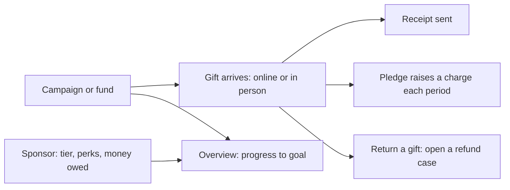

# Fundraising (donations)

The Fundraising role is the Space Manager's delegate for donations. You run campaigns, gifts, pledges, sponsors, the donor list and receipts, and nothing else of the space's money. You hold no settings and you never see an area manager's Finance view. The non-profit profile stays the Space Manager's alone.

Donations need the Donations feature on (**Settings**, **Areas**, **Features**). A non-profit with a valid registration also gets a **Donate** link on its public pages.

## Your daily loop

## The screens you see

Open **Donations** in the menu. Tabs: **Overview**, **Gifts**, **Campaigns**, **Pledges**, **Donors**, **Sponsors** and **Non-profit and receipts** (the non-profit profile is the Space Manager's alone to edit).

## How do I start a campaign?

Under **Campaigns**, **New campaign**: a campaign with a goal and dates, or a fund that is always open. **Overview** shows each campaign's progress towards its goal.

## How do I record a gift?

1. **Gifts**, **Record a gift** for money received in person.
2. A gift someone promised online waits for payment. Press **Mark received** when the money arrives, or **Confirm payment** when the giver says they paid.
3. **Send receipt again** emails the giver their receipt.
4. **Download CSV** exports the gift list.
5. To give money back press **Return...** then **Open refund case**. Returning only opens a case; staff with refund authority decide it.

Every gift is income in the ledger.

## How do pledges work?

A pledge raises a charge each period with no card stored. Under **Pledges** you can see each one. Givers change the amount or frequency, **Pause**, **Resume** or **Cancel pledge** from their own page.

## What about tax receipts?

The Space Manager fills in **Non-profit and receipts**: **This makerspace is a non-profit**, legal name, registration number, each tax-exemption registration (scheme, number, valid dates), who signs and a receipt footer. Schemes include India 80G and 12A/12AB, US 501(c)(3), and UK, Canadian and Australian charity numbers.

- **Non-profit with a valid registration:** givers can ask for a tax receipt. India 80G asks for PAN and postal address. The receipt is fixed the day the gift arrives.
- **Otherwise:** gifts still work, and every receipt says it is not a tax receipt.

> **Note** India 12A on its own does not allow tax receipts; the space needs its 80G registration too.

## How do I protect donors' privacy?

**Donors** lists who gave, how often and how much. A PAN or address never appears there or in the export. Every gift is anonymous on public pages unless the giver ticks **Name me among this campaign's supporters**.

## How do I manage sponsors?

1. **Sponsors**, under **Tiers and perks**: **Add tier** with a suggested amount and perks.
2. Under **Sponsors**: **Add a sponsor** (name, tier, website, dates, a private contact).
3. Tick **Show on the public sponsor wall**, add a one-line description and a logo.
4. Under **Sponsorship money**: **Record as owed**.
5. Link the sponsor to an event and tick off perks as you deliver them.

To show the wall, the space adds a **Sponsors** section to a public page. Contact details stay private.

## What do givers see?

On the space's **Support** page (`/donate`) a giver chooses an amount, where it goes (general, a campaign or a fund), how often (**Once**, **Every month**, **Every quarter**, **Every year**), and asks for a tax-exempt receipt if offered. Not signed in? They get an emailed code. After giving, **My gifts** shows **Waiting for payment**, **Received** or **Cancelled**. See [Member guide](member.md).

## What can I not do?

Change settings, see event or booking money, or decide refunds for other areas.

## Related

[Take payments](../tutorials/take-payments.md) · [Payment documents](../payment-documents.md)
