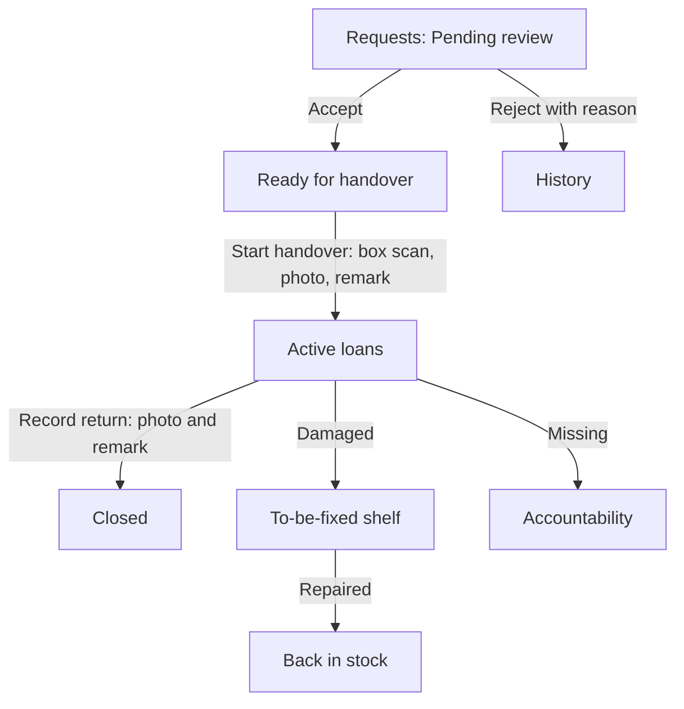

# Inventory Manager

The Inventory Manager runs the tool library: reviewing borrow requests, handing tools over and taking them back, keeping the catalogue accurate and managing QR labels. You can run the full hardware lifecycle but **not** printing, staff or makerspace settings, and you hold no money actions. This role is combinable with others, such as Handover.

## Your daily loop

## The screens you see

**Requests**, **Direct handout**, **Ledger**, **Accountability**, **Inventory** (shown as **Items**), **Categories**, **Repair shelf** (To-be-fixed), **Stocktake**, **Transfers**, **Containers**, **Bulk import**, **QR Tools**, **Scanner**, **Consumables**, **To buy**, **Warranties**. Which appear depends on the features your space switched on.

## How do I review borrow requests?

1. Open **Requests**. The queues are **Pending review**, **Ready for handover**, **Active loans** and **History**.
2. Press **Review** on a request. To accept, press **Accept**; lower any line, or set it to 0 to decline just that item; press **Accept** again.
3. To reject, press **Reject**, give a **Reason** the member will see, and **Reject request**.
4. From a request's menu: **Set due** then **Save due date**, or **Cancel request**.

Accepting reserves the items so others see them as unavailable until handed over or released.

## How do I hand something over?

1. **Requests**, **Ready for handover**, **Start handover**.
2. **Scan container:** scan the box QR.
3. **Check borrower card:** scan or look at the card and tick that you checked the person.
4. **Check items:** confirm each item. Use **Scan items continuously** for QR-tagged tools.
5. **Photo and confirmation:** take the issue photo, add a remark, **Confirm issue**. **Print receipt** if wanted.

You can never issue without a box scan and a photo, or more than was accepted. A broken unit: **Reject as broken** and choose the repair shelf or out of inventory.

## How do I lend without a request?

Use **Direct handout**, **New handout**: **Scan member card** or choose the borrower, scan or select tools, take the photo and remark, **Confirm handout**. To take it back, open **On loan** and press **Return**. **Claim codes** lets a borrower link a handout to their account later.

## How do I take a return?

1. **Requests**, **Active loans**, **Record return**.
2. Scan the box and check the borrower.
3. Mark each item **Returned**, **Damaged** or **Missing**. Anything marked **Not returned now** stays on loan.
4. Take the return photo, write the **Return remark**, **Confirm return**.

Damaged items go to the repair shelf; missing items stay on the borrower's record. If the space charges for damage or loss, a charge step follows and you set the amount.

## How do I manage items and categories?

- **Add item:** name, category, quantity, tracked as a count or as individual units with their own QR, public visibility (listed or not; exact count, status only or nothing). Then add an **Item photo**.
- **Adjust quantities:** open an item, **Adjust quantities**, change available, damaged or lost, and give an **Adjustment reason**. Counts never go below zero; every adjustment is audited.
- Other item actions: **Show QR**, **Loan history**, **Move to repair shelf**, **Add to To buy**, **Archive** (restore from **Archived**). **Export CSV** and **Export Excel** download the list.
- **Categories:** **Add category** (name, short name, icon, order).
- **Bulk import:** upload a CSV or Excel file, paste a table or use JSON, **Match columns**, **Review**, **Import**. Add a **qr_code** column to link existing labels.

## How do I manage QR labels and boxes?

- **QR Tools** (the page is **QR labels**): **New batch**, **Add labels** for an item and a number of units, **Download all (ZIP)** and print. **Reprint a unit** replaces a label.
- **Scanner:** scan any label to see what it belongs to; **View contents** lists a box. **Revoke QR** stops a lost or copied label everywhere at once. Scanning an unlinked label offers **Create new item** or **Link to existing item**.
- **Containers:** **New container** (box, bin or shelf), print its label, see its **Scan history**. Kit checklists make staff count each part at handover and return.

## How do I keep counts honest?

- **Stocktake:** **Start count**, choose a container, choose **Show expected** or blind counting, count, **Complete count**, review differences, **Approve** and **Apply adjustments**.
- **Transfers:** **New transfer**, choose from and to (a space and container each side), add products and quantities and a reason, **Move stock**.
- **Consumables:** **Log use**; **Running low** opens **To-Buy** with a draft waiting.
- **Repair shelf:** **Repaired** returns units to stock; **Scrap** removes them for good. Bigger fixes can go to a technician.

## How do I see who has what?

- **Ledger:** everything out now. Filter by **Reviewed**, **Direct** or **Self-checkout**, or tick **Overdue only**. Search, sort, export.
- **Accountability:** tabs **All**, **Overdue**, **Problems**, **Repeat offenders**, **Restricted**. **Open loan** shows the handover and return evidence. Borrowers without an account are shown as totals only. Restricting a borrower is the platform administrator's act; ask them with the loan and the reason.

## What are my loan rules?

**Inventory settings** (from the menu on the Inventory page) holds the **Loan policy** (length, renewals), **Borrow limits**, **Loan reservations** and **Pickup windows**, **Loan waitlist** and **Withdraw requests**. You can always change loan length and renewals, unless the Space Manager locks them. Other switches need a grant of control from the Space Manager.

**Waive a loan fee:** open the request, **Charges**, **Waive fees**, tick the fees and give a reason. Deposits are never waived; an already-paid fee opens a refund for staff to approve.

## What can I not do?

Accept money, change settings, manage staff, or restrict a borrower. Evidence photo rows and scans are permanent; you cannot edit or delete them.

## Related

[Tutorial: Lend your first tool](../tutorials/lend-your-first-tool.md) · [Loan policy](../loan-policy.md) · [Handover desk guide](handover-desk.md) · [Equipment kits](../equipment-kits.md)
