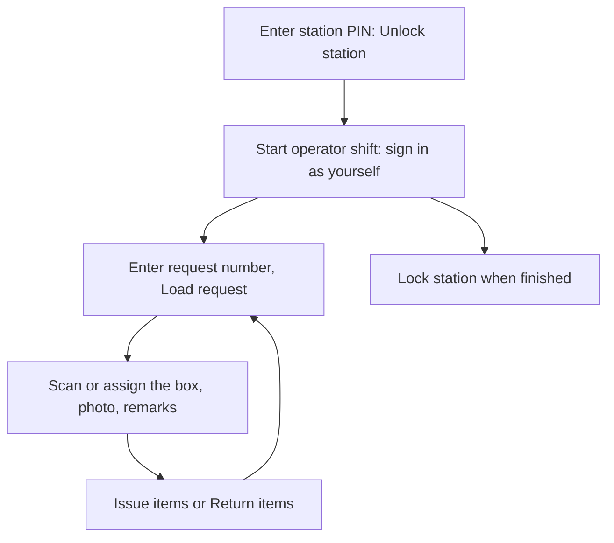

# Kiosk

A kiosk is a shared device at the desk. There are two kinds, and they work differently.

| Kind | Address | Who uses it | Needs sign-in? |
| --- | --- | --- | --- |
| **Public desk** | `/kiosk/<space>` | Visitors browsing and requesting | No. A **Staff sign-in** link sits at the bottom |
| **Station** (**Handover** or **Scanner**) | `/kiosk/<station token>` (or `/m/<space>/kiosk/<station token>`) | Staff working the desk | The station PIN unlocks the device; the person working it signs in as themselves |

A station is not a person. Its PIN only unlocks the device. Every handover is recorded against the signed-in operator's own account and role, so the audit trail still says who did it.

## Your daily loop

## How do I set up a station? (Space Manager)

1. Make sure the kiosk feature is on (**Settings**, **Areas**, **Features**, inventory kiosk).
2. Open **Settings**, **Inventory**, **Kiosk stations**.
3. Name the station, choose **Handover** or **Scanner**, and press **Create station**.
4. Copy the PIN (it is shown once) and the station's address.
5. Later you can **Rotate PIN**, **Reveal PIN**, **Disable**, or re-enable with a new PIN.

## How do I work a shift?

1. On the device open the station address and enter the station PIN (an 8-digit number from a manager). Press **Unlock station**.
2. Press **Start operator shift** and sign in as yourself with an account allowed to work stations.
3. Enter a request number and press **Load request**.
4. Scan or assign the box, take the photo and add remarks.
5. Press **Issue items** or **Return items**.
6. **Full screen** enters kiosk mode; **Lock station** ends the session.

## What if the connection drops?

Keep working. The station queues the work, encrypted on the device, and sends it when it is back online. The screen says **Queued** with a sequence number and a pending count until the server confirms each handover.

- An offline shell cannot unlock the station or look up people, requests or QR codes. Only work you loaded while online can be continued.
- On reload without a connection, the screen says **Reconnect to unlock and load this handover**. If a queue exists you can **Continue with encrypted queue**.
- If you press **Lock station** with queued work, you are asked whether to discard it. Pending or failed work is never silently thrown away.
- Replay runs automatically when you are back online and every 15 seconds. A failed handover keeps a clear reason and blocks only that record. See [Kiosk offline continuity](../KIOSK-OFFLINE.md) and [failed replay recovery](../KIOSK-RECOVERY.md).

> **Warning** An offline station cannot see that its PIN, a session or an operator has been revoked until it reconnects. Disable a lost device's station as soon as you can.

## What does the public desk do?

The public desk shows the space's **Inventory** with a request panel and a **Need a hand?** card with support contact and a map link. Visitors need no sign-in to browse; submitting a request follows the space's rule on who may request. Staff reach the console through **Staff sign-in**.

## What can a station operator not do?

Station work is limited to what the operator's role allows. Handover-only staff can issue and return but cannot accept requests or change inventory.

## Related

[Handover desk guide](handover-desk.md) · [Kiosk offline continuity](../KIOSK-OFFLINE.md) · [Kiosk recovery](../KIOSK-RECOVERY.md)
