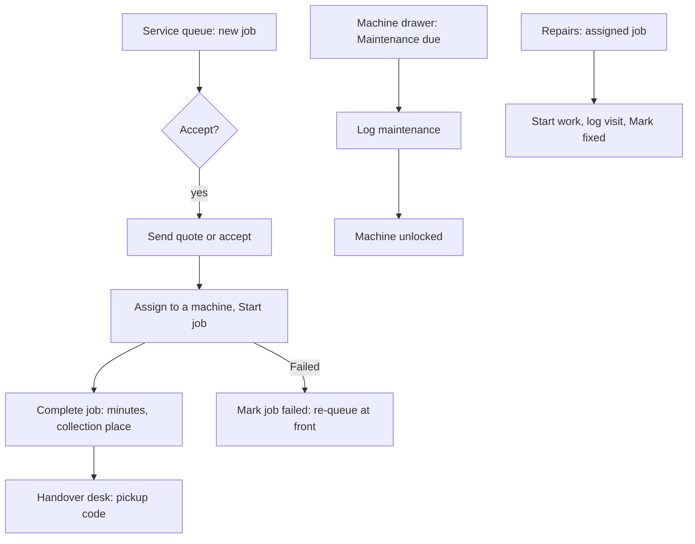

# Machine Manager and Technician

Two roles share this guide because they share the maintenance and repair screens.

- A **Machine Manager** runs the machine lifecycle for the machine types and individual machines the Space Manager assigned: types, machines, the job queue, sessions, certifications and maintenance. A Machine Manager with no types picked sees no machines.
- A **Technician** works the repair jobs assigned to them, runs scheduled maintenance and sets service state, only within the coverage the Space Manager gave (certain machine types, all items, or named rooms). With no coverage, a technician sees only the repair jobs assigned to them. Technicians have no inventory, money or settings access.

## Your daily loop

## The screens you see

**Machines** (type pages with **Machines**, **Service queue**, **Queue board**, **Consumables**, **Certifications**, **Settings**), **Devices**, **Repairs** (**Queue**, **My jobs**, **Maintenance**, **Technicians**), and where granted **Warranties** and **To buy**.

## How do I set up machines?

1. **Machines**, **Add machine type**: name, icon, and how use is measured (weight, volume, length, a count or minutes). **Create type**.
2. Open the type, **Add machine**, fill in the form, **Add**. Optionally a photo and warranty.
3. Click a machine for its drawer: **Overview**, **Operators**, **Consumables**, **Usage**, **Maintenance**, **Documents**, **Errors**, **Warranty**, **Sessions**. **Mark running** or **Mark idle** sets its state.

Creating and editing types needs type-configuration rights; otherwise types are read-only for you.

## How do I run the job queue?

Members can request machine work such as 3D prints and laser cuts. Printing is a machine type like any other.

1. **Machines**, open the type, **Settings**, **Job requests**: tick **Members can send job requests for this type**, choose when a quote is needed (when the job has a price, always, above an amount, or never), choose when members pay (when done, or before joining the queue), set open jobs per member and the longest job, **Save job settings**.
2. Open **Service queue**. For each request: **Accept job**, **Send quote**, **Ask for changes** or **Reject job**.
3. **Assign to a machine**, **Start job**. **Mark urgent** moves it up.
4. **Complete job** with actual minutes and where to collect it. If it went wrong, **Mark job failed** with what happened and whose fault it was. A run that fails by the space's or machine's fault costs the member nothing and goes to the front of the queue.
5. With batch start on, open **Queue board**, tick two or more jobs, **Start as batch**, then **Complete batch**.
6. **Log usage** records filament and minutes used outside a job.

Finished jobs are handed over at **Job pickups**; see the [handover desk guide](handover-desk.md).

## How do I train and certify people?

1. Open the type, **Certifications**, **New certification type**. Name it, set validity in days (blank means never expires), tick **Required for service requests** and **Required for bookings**, **Save certification**.
2. **View grants**, choose the member, **Grant certification**. Later **Renew** or **Revoke** with a reason.
3. To certify a group at once, open an event's **Overview**, use the **Induction** panel to **Mark as induction**, then **Grant certification to N selected** for checked-in attendees.
4. Set **Reminder policy** under the type's **Settings** to remind members before expiry.

Without a certification a job request or booking on that type is refused. A staff booking can override with a reason, and overrides are audited.

## How do I run machine sessions?

1. Type **Settings**, **Machine sessions**: set the **Longest session**, **Save**.
2. Machine drawer, **Session QR**, **Show QR**; print it onto the machine.
3. **Sessions** view: lists **Live**, **To check** and **Closed**. **Start for a member**; on a session **Stop session**, **Confirm**, **Correct time** (minutes and reason) or **Assign member**.

A session stops itself at the longest length, at check-out or at closing time, then waits in **To check**. Sessions bill the type's hourly rate only while machine charges are on. Members must be checked in and certified.

## How do I schedule maintenance?

1. Machine drawer, **Maintenance**, **New schedule**: trigger by days, or by hours or jobs where meters are on; count from completion or a fixed calendar; **Create schedule**.
2. **Log maintenance** (or **Complete maintenance** on a due item) with what was done, parts and notes.
3. One-off work: **Work orders**, **New work order**, **Start work**, **Close work order** with cost and parts.
4. **Maintenance calendar**, **Create or rotate calendar link** gives a personal calendar feed.

Overdue maintenance **locks out** the machine until it is logged.

## As a Technician: how do I work a repair?

1. **Repairs**, **My jobs**, open a job, **Start work**.
2. From the job's menu: **Log a visit** (date, who came, what happened, photos), **Add a remark**, **Part used** (taken from stock), **Part needed** (added to To-Buy), or **Record a quote**.
3. When it works again, **Mark fixed**, say what was fixed, add photos. The reporter is told; you see their first name only.
4. A quote you record waits for the area manager or Space Manager to approve. You never handle payment.
5. **Run scheduled maintenance:** **Repairs**, **Maintenance**, pick an **Overdue** or **Due today** row, fill in **What was done**, **Log maintenance**.
6. **Take something out of service:** open the issue, **In or out of service**, choose **Out of service** or **Back in service**, give a reason and expected return. For a room choose **Block new bookings** or **Only warn**; for items say how many units.

When a room or machine goes out of service, bookings during the outage are listed and bookers emailed; staff then cancel each with a full refund or keep it.

## As a manager: how do I triage repairs?

1. **Repairs**, **Queue**: filter **Open**, **New reports** or **Fixed and closed**.
2. **Triage** a member's report and set priority, or **New repair job** for something you found.
3. **Send to technicians** (the area's usual technicians are pre-ticked) or **Assign to me**.
4. **Technicians**, **Add technician**: **Someone on staff** or **Outside contractor (no account)**, with email, phone or chat and what they cover. For chat, **Send chat opt-in link** (valid seven days).
5. On a job with a quote: **Approve quote** or **Decline quote**. When the work is paid for: **Record payout** (amount, how, reference, date), then **Close**. A payout is recorded in the finance ledger; no money moves from this screen.

Only the Space Manager sets a technician's coverage.

## Connected devices

**Devices** lists enrolled printers and label printers; enrolling is a Space Manager action. Machine integrations are covered in the [machine integration guide](../machine-integrations/INTEGRATION.md).

## Related

[Tutorial: Machines and inductions](../tutorials/machines-and-inductions.md) · [Machine training and maintenance](../machine-training-maintenance.md) · [Device protocol](../device-protocol.md)
