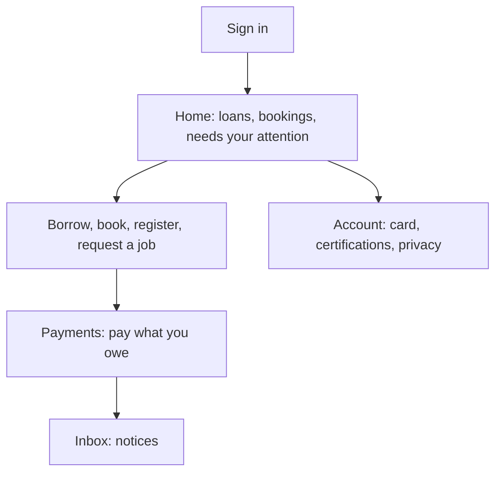

# Member

One Space Works account works at every space you join on the same site. Each space chooses what it offers: a tool library you borrow from, rooms you book, events, machine jobs, a shop, and more. Anyone can browse a space's public pages; borrowing, booking and machine jobs need an account, and usually an active membership and an accepted waiver.

## Your daily loop

## How do I get started?

1. Open the space's page (on a shared site `/m/<space>`). Browse **Inventory**, events and bookings without signing in.
2. **Sign in**, then **Create account** if you are new.
3. If the space has memberships, open **Home** in your member area and find **Join this makerspace**.
4. Accept the space's waiver with **Accept waiver** when it appears.

## How do I join a space?

On **Home**, **Join this makerspace**: choose a plan under **Choose a plan**, answer any questions, then press **Join instantly**, **Apply to join** (pay first) or **Request to join** (staff approval or vouching). The status card reads **Membership request sent**, **Membership awaiting payment** or **Membership awaiting vouches**. **Cancel application** withdraws; **Download application data** saves your answers.

If vouching is needed, share your application number with a member, who enters it under **Vouch for an applicant**. By default one vouch is enough; applications expire after 30 days. No invitation yet? Use **Ask for an invitation**. Closed spaces say so.

## How do I find my way around?

Your member area lives at `/member` (on a shared site `/m/<space>/member`). Tabs follow what the space runs: **Home**, **Loans**, **Bookings**, **Events**, **Payments**, **Inbox** and **Account**.

## How do I borrow?

1. Open **Inventory**, search or pick a category.
2. Press **+** on each item; it goes into **Your request** (on a phone, **Review request**).
3. Describe the use under **Request purpose**, choose **When will you collect?** if asked, **Submit request**.
4. When it is accepted, collect it at the desk: staff scan the box and photograph the handover.
5. **Renew:** **Loans**, **Out now**, **Renew loan** (not possible if someone is waiting or your membership lapsed).
6. **Return:** bring it to the desk. Returns are never refused.

Out of stock? **Join the waitlist** (you see your place; when it says **Ready for you** press **Request it**), or **Notify me when back**. **Withdraw** a pending or accepted request under **Loans**, **History**.

**Self-checkout:** where the space allows it, open **Borrow or return a tool** (`/checkout`): choose **Borrow**, photograph the tool, **Scan QR**, **Confirm checkout**. To return choose **Return**, photograph it, add **Return condition notes**, **Confirm return**. A photo is always required.

## How do I book a room or resource?

1. **Book a makerspace** (`/bookings`) or **Book a space** in **Bookings**. A resource says **Needs approval** or **Instant when available**.
2. **Choose a time**, then **Book this slot** (or **Submit booking request**).
3. **My bookings**, **View confirmation** gives your calendar links, **Download printable pass** and the arrival QR. Keep the QR private; **Replace private QR** if it leaks.
4. **Reschedule booking** or **Cancel booking** before the cut-off. After your slot, **Check out** and tell the space how it went.

Included hours from your membership plan, or an organization's hours bank, are used before any charge.

## How do I find and join events?

1. **Events** (or **Discover** across spaces): search, or filter by **Free events**, **Registration open**, category or tag.
2. **Register** (**Join waitlist** or **Apply** where the organisers choose), pick a **ticket**, add an invitation or promo code, accept the host's waiver, submit. You see **Registration received**, **You're on the waitlist** or **Application awaiting approval**.
3. Your ticket and check-in QR are in your **Events** tab (**Open ticket**, **Download ticket PNG**). **Cancel registration** before the deadline.
4. Afterwards: **Leave feedback**, and download **Certificates**.

## How do I use machines?

- **Request a job** (`/machine-jobs/new`): choose a type, add files, fill in details, tick the confirmations, **Send request**. Follow it under **My machine jobs**: **Approve quote** or **Decline**, **Pay now** on prepaid types, then show your **Pickup code** at the desk. Collect within 14 days.
- **Use a machine yourself:** scan the machine's QR (page **Use this machine**), check the rate and longest session, **Start session**, **Stop session**. You must be checked in and certified.
- **Certifications:** **Account**, **Certifications** shows each training as **Valid**, **Expired** or **Revoked** with an end date.

## How do I pay?

Everything you owe is under **Payments**: bookings, event places, machine jobs, dues, deposits and late fees.

1. **Pay now** to pay online (card or the space's provider), or **Pay at the space** if there is no online payment.
2. Where offered, pay by UPI: scan the QR or **Open UPI app**, enter the **Transaction reference (UTR)** and date, **I've paid**. Staff confirm.
3. **Payment documents**, **Show documents**, **Download PDF** for receipts.
4. **Request refund**, give a reason, **Send request**. Staff decide every refund. A loan deposit is returned when the loan closes.

"Nothing to pay. You are all settled." means you are clear. If your account was restricted because of an unpaid or lost-item charge you can still see and pay your own charges.

## How do I give to the space?

Open **Support** (`/donate`): choose an amount, where it goes, how often, add a receipt request if offered, then **Continue to payment**, **Give** or **Make my pledge**. Your gifts are under **My gifts**.

## How do I look at what I did before?

**Your history** (from **Home** or **Account**) lists **Borrowing history**, **Event history**, **Booking history**, **Shop orders** and **Payments & receipts**, with filters and pagination. It never shows anyone else's records.

## How do I stay in the loop?

**Inbox**: **Notices** (your own loans, bookings, jobs, payments; **Mark read** or **Mark all read**) and **Announcements**. **Channels** lets you add Telegram, WhatsApp and other channels (chat apps ask you to opt in once) and choose what goes where. **Preferences** unticks optional messages or bundles them into a **Daily digest**. Safety and account-recovery emails always stay on.

## How do I show my card and check in?

**Account**, **Card**, **Show QR to scan**; **Save card for offline use** works without signal. Where presence is on, **Home**, **Presence**, **Check in** (allow location once) records that you are in the space.

## How do I control my data and privacy?

- **Download your data:** **Account**, **Your data**, **Request data export** (once a day); when available, **Prepare download link**, **Download ZIP**. It holds your records as JSON without photos or uploaded files; the link expires.
- **Consents:** **Account**, **Privacy**, **Consents**: tick or untick each purpose; it applies at once.
- **Ask a space to erase your data:** **Account**, **Privacy**, **Erase my data here**, **Ask to erase my data**; **Withdraw** cancels. If staff approve, your membership at that space ends and your record, profile and answers there are erased. Payment records and the audit trail stay as the law requires, and your account itself stays.
- **Delete your account:** **Account**, **Delete account**, type `DELETE`, **Delete account permanently**. It covers every space you belong to. For a while afterwards (90 days unless the site says otherwise) you can restore it through a password recovery and the **Restore your account** page, though memberships and sessions do not come back. Some things block deletion, such as money you owe. See [Account deletion and privacy](../privacy-account-deletion.md).
- **Personal API tokens and connected apps:** account menu, **API access & connected apps**; revoke a token when you finish.
- **Security:** **Account**, **Security** has two-step sign-in and passkeys; security emails include "This wasn't me".

## How do I report something broken?

From the place you used it: a tool under **Loans**, your loan, **Report a problem**; a machine from your job page; a room from **My bookings**, then the booking. Choose **Which item**, fill **What's wrong** and **Details**, add up to six photos, **Send report**.

## Related

[Sign-in and borrowing](../sign-in-and-borrowing.md) · [Account portability](../account-portability.md) · [Tutorial: Lend your first tool](../tutorials/lend-your-first-tool.md)
