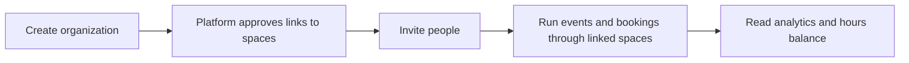

# Organization admin

An organization is a shared profile for a group that works with one or more spaces: a college club, a company, a community group. It has its own people and public page, and can run events through the spaces it is linked to. You are an organization **owner** or **governor**.

An organization grants access to actions, never to identity: belonging to one never shows you anyone's personal details.

## Your daily loop

## How do I create an organization?

1. Open **Account** in your member area and find **Create your organization**.
2. Fill in **Organization name** and **Organization slug** (the short name in its address).
3. **Create private organization**, then **Manage your organization**.

Where self-creation is off on this site, ask the platform administrator to create it for you. A platform administrator also **links** your organization to spaces; you cannot link it yourself.

## What are the organization's tabs?

Open the staff console's **Organizations** tab and pick your organization. Tabs: **Profile**, **Public page**, **People**, **Invitations** and **Spaces** (the last is the platform administrator's). **Included hours** and **Event email sender** appear where those features are on.

## How do I invite people?

1. **Invitations**, **Invite someone**.
2. Optionally add an email to tie the link to one person, and choose how many days it lasts.
3. **Create invitation**, **Copy link**, send it.

The person opens the link (**Join an organization**), signs in and presses **Sign in and continue**. Each link works once; revoking stops it at once.

Under **People** use **Suspend** or **Reactivate** and grant or revoke governor seats.

## How do I edit the public page?

Under **Public page**, arrange sections and publish. The page lives at `/o/<organization>` and lists linked makerspaces and organization events, upcoming and past. **Visit website** points to your own site. Only public spaces and listed events appear.

## How do I see our events?

**Organized events** in the staff console: switch between **All events**, **Upcoming** and **Past**, and open an event to see it in the hosting space. Members of the organization can register for events a space opens to participating organizations. These tabs are hidden on a single-space site.

## How do I see our hours and analytics?

- **Included hours:** where your space gives the organization an hours bank, you can read the balance and ledger for each space. Room bookings made for the organization draw from it before any charge; cancelling returns the hours. Only space staff can change the allowance.
- **Org analytics:** **Choose an organization** and a **Report**; read the **Organization total** and the **Breakdown by makerspace**. Different currencies and units are never added together.

## How do I invite another makerspace to host us?

Where you hold the right, **Invite a makerspace** (under the organization) sends a hosting invitation; the platform administrator reviews it.

## How do I leave?

Open **Account**, **Your organizations**, **Leave** beside the organization, tick that you understand your access will end, **Leave organization**. A sole owner must appoint another owner first.

## What can I not do?

Link to a space (platform administrator), change hours banks (space staff), or see members' personal details.

## Related

[Take room bookings](../tutorials/room-bookings.md) · [Member guide](member.md)
