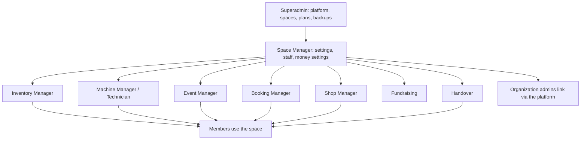

# User guides

Each guide is written for one role and organised as "How do I...". It names the menu entries and buttons that role sees, so you can follow along on screen. Screens appear only for roles that hold the matching permission and for areas the space has switched on.

## The built-in roles

A person can hold several staff roles at once; together they decide what the console shows. **Space Manager** and **Member** are always held alone.

| Role | Holds | Guide |
| --- | --- | --- |
| Platform administrator (superadmin) | Everything on the platform | [Superadmin](superadmin.md) |
| Space Manager | The whole space: settings, staff, money settings | [Space Manager](space-manager.md) |
| Inventory Manager | Requests, handovers, items, QR codes, stocktakes | [Inventory Manager](inventory-manager.md) |
| Machine Manager, Technician | Machines, jobs, sessions, certifications, repairs | [Machine Manager and Technician](machine-manager-and-technician.md) |
| Event Manager | Events, tickets, check-in, programmes | [Event Manager](event-manager.md) |
| Booking Manager | Rooms and resources, booking requests | [Bookings Manager](bookings-manager.md) |
| Shop Manager | The pickup shop: products, stock, orders, front desk | [Shop Manager](shop-manager.md) |
| Fundraising | Donations, campaigns, pledges, sponsors | [Fundraising](fundraising.md) |
| Handover | The front desk: handing tools over and taking them back | [Handover desk](handover-desk.md) |
| Organization owner or governor | An organization's people and page | [Organization admin](organization-admin.md) |
| Member | Borrowing, booking, events, paying, privacy | [Member](member.md) |
| Station operator | A shared desk device | [Kiosk](kiosk.md) |

> **Note** The ten built-in roles are fixed and cannot be edited or created anew; a person's screens are the combination of every role they hold. Where a screen is missing for you, check your roles (**Staff & roles**, **Roles** tab shows what each role holds) and whether the space has the area switched on under **Settings**, **Areas & add-ons**.

## How the pieces fit

## Two rules that explain most surprises

1. **Switching something off hides it and keeps its data.** Only the platform administrator can delete data, and always with a preview.
2. **Staff only ever see their own space.** Everything is scoped to one makerspace. The platform administrator is the exception and is audited in every space.

See also the [tutorials](../tutorials/overview.md) for end-to-end walkthroughs and the in-app **Help** (`/help`) for a short article on every screen.
