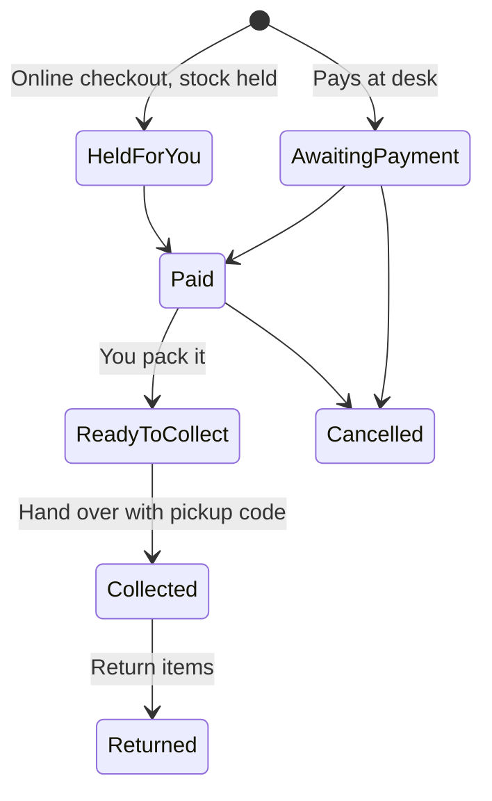

# Shop Manager

The Shop Manager runs the space's pickup-only shop for kits, consumables and merchandise. You hold three actions: manage the shop (catalogue, prices, stock, returns, cash-ups, the shop's own settings), sell at the front desk, and view orders and stock. You hold no other inventory, no money outside the shop and no other settings. Nothing is shipped; buyers collect at the space, or at an event where event pickup is on.

## Your daily loop

## How do I switch the shop on?

The Space Manager does this part: **Settings**, **Areas & add-ons**, turn on **Shop**, then under **Features** tick **Track money owed** and **Track shop sales** (without sales tracking buyers can browse but not order, and the till cannot sell), and give you the **Shop Manager** role under **Staff & roles**. Then you open **Shop**, **Settings**.

## What are the shop's switches and policies?

Under **Shop**, **Settings** you choose features: **Online shop**, **Guest checkout** (buyers without an account, after an emailed code), **Stock holds at checkout**, **Member prices**, **Shop tax classes**, **Returns and refunds**, **Cash-up**, **Pickup at events**, **Per-order limits**, **Stock on the shop page**, **Shop receipts**, **Low-stock reorder**, **Kit bundles** and **Sell inventory consumables**. The Space Manager can lock a switch; locked ones are read-only for you.

| Policy | Default |
| --- | --- |
| Online hold | 15 minutes (5 to 120) |
| Pay-at-desk hold | 48 hours (1 to 720) |
| Returns window | 14 days after payment (0 to 365; 0 means no returns) |
| First pickup reminder | 3 days after ready |
| Second pickup reminder | 7 days after ready |
| Cancel uncollected after | 30 days |
| Pickup note | up to 300 characters |
| Shop policy | up to 2,000 characters, shown before ordering and paying |

## How do I add products and stock?

1. **Shop**, **Catalogue**, **New product**: name, kind, category, unit, description.
2. Choose **Show on the public shop page** and **On sale**. A desk-only product stays out of public browsing.
3. Add a **variant** for each sellable size or colour: name, SKU or barcode (unique in this shop), price, active state, up to three option pairs.
4. Where enabled: **Members only**, per-order maximum, exact public stock, tax rate and HSN code, reorder point.
5. Save, reopen the product and add its **Product photo**.
6. **Shop**, **Stock**: each variant shows on-hand, held and available. **Restock** adds arrivals; **Adjust**, **Shelf count** records a counted total; **Damaged** and **Used in the space** take stock out with a reason; **History** lists movements.

Prices include tax where tax classes are on. There is no separate member-price field: the Space Manager creates member discounts under **Settings**, **Pricing**, **Member discounts** and can scope one to **Shop**. Archiving a product removes it from sale and keeps old orders and stock history. Stock cannot go below zero or below live holds. Public pages show **In stock**, **Low** or **Sold out**.

## How do I sell at the front desk?

1. Open the shop's front desk. Where cash-ups are on, open a cash session with your opening float.
2. Scan or search products. Look up the member for a member price.
3. Take payment (cash, UPI or card on your own terminal) and record how it was paid. Space Works records the payment; it does not talk to the card terminal.
4. Print the receipt (80 mm or A4) or email it.

**Hand over online orders:** find the order by its pickup code (**Ready to collect**), check the code with the buyer, **Hand over**. The status becomes **Collected**.

**Cash up:** at closing enter the cash you counted; the difference from expected is shown and a second person can confirm.

## How do I manage orders and returns?

Statuses: **Held for you**, **Awaiting payment**, **Paid**, **Ready to collect**, **Collected**, **Could not be filled** (payment arrived but stock could not fill it; staff review the refund case), **Cancelled**, **Returned** (goods taken back; this does not confirm money was refunded).

- **Cancel** an unpaid order: no money moves and stock goes back.
- **Return:** open a collected order, **Return items**, choose items, mark each **Back to stock** or **Written off**, **Record return**. A refund case opens; decide it under **Refunds**. Money only goes back through a staff-approved refund case.

Buyers follow their order and receipts under **My shop orders**.

## What can I not do?

Change member discounts, tax, billing or online-payment settings (Space Manager), or touch non-shop inventory. Online payment needs the Payments add-on and configured credentials; without it the ledger still records what is owed and you take payment at the desk.

## Related

[Payments tutorial](../tutorials/take-payments.md) · [Pricing and discounts](../tutorials/take-payments.md#part-2-set-a-price)
