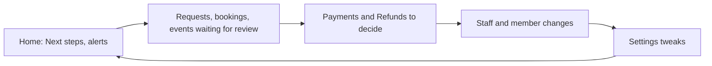

# Space Manager

The Space Manager runs one makerspace. You hold every action in your space, which means you can open any area's screens, and you are the only role that can change money settings (tax, pricing, billing, payments) and security settings. The platform administrator gives you the role; you then give everyone else theirs.

## Your daily loop

## How do I find any setting?

Open **Settings**. Use **Search settings** at the top ("loan days", "logo", "WhatsApp"). The menu is grouped like this:

| Group | Pages |
| --- | --- |
| **Space** | **Overview**, **Profile & location**, **Branding & public site**, **Public page**, **Public stats** |
| **People** | **Staff & roles**, **Membership**, **Guest passes**, **Community**, **Presence privacy** |
| **Areas** | **Areas & add-ons**, **Features**, **Inventory**, **Machines & materials**, **Events**, **Bookings**, **Shop** |
| **Money** | **Payments & billing**, **Pricing**, **Non-profit and receipts** |
| **Communication** | **Notifications**, **Communication channels**, **Email sending**, **Email templates**, **Delivery log** |
| **Integrations** | **Webhooks**, **Integration health**, **API access** |
| **Administration** | **Privacy & evidence**, **Invite a makerspace**, **Security**, **Audit log**, **Data export**, **Backup & restore**, **Usage & limits**, **Move to another server** |

Pages for areas you have switched off do not appear.

## How do I get started with a new space?

1. When you first open the console the **guided setup** walks through five steps: name, logo, opening hours, what your space runs, and staff. Every step has **Skip for now**.
2. The **Next steps** card on **Home** tracks what is left (address, logo, opening hours, first item, staff, areas). The ticks come from real records.
3. **Settings**, **Overview** holds a second checklist: address, logo, support email, features, notifications and (with memberships) the check-in area.

Walkthrough: [Set up your first makerspace](../tutorials/first-makerspace.md).

## How do I choose what the space runs?

1. **Settings**, **Areas & add-ons**: flip a whole area (Inventory, Machines, Events, Bookings, Shop and more) or an add-on (SMS, chat apps, analytics). A row that needs another says **Also installs**; a toast offers **Undo**.
2. **Settings**, **Areas**, **Features**: tick the finer switches inside each area.

Switching off hides and keeps data. Purging is the platform administrator's step. See [Choosing modules](../choosing-modules.md) and the [switch-off reference](../MODULES-OFF.md).

## How do I add and manage staff?

1. **Staff & roles** (the menu entry is **Users**), **Add staff**.
2. Under **Add by** choose **A member of this space** or **Invite by email**.
3. Tick roles. For a Machine Manager or Technician choose what they cover; a Machine Manager with no machine types sees no machines.
4. **Grant roles** or **Send invitation**.

On a row: **Change roles**, **Revoke**, **Restore**, **Reset authenticator** (lost device). The **Invitations** tab lists pending invites; the **Roles** tab shows what each role holds. You can only grant roles whose actions you hold. Only the platform administrator gives or removes Space Manager.

## How do I let an area manager change their own settings?

By default area managers see their area's settings but cannot change them.

1. **Settings**, **Overview**, **Who can change settings**.
2. Pick **Event settings**, **Booking settings**, **Machine settings** or **Inventory settings**.
3. Press **Give control to**, choose a person, **Give control**. **Remove** takes it back.

To hold one setting yourself, open it and press **Lock for managers**. A lock never applies to you. Inventory Managers can always change loan length and renewals unless you lock them. Money and security settings can never be handed over.

## How do I run the public site?

- **Branding & public site:** public display name, **Logo**, **Banner (wide image)**, colours (checked for readability), support email, **Custom domain** (add the DNS TXT record, then **Verify domain**).
- **Profile & location:** timezone, **Opening hours**, **Dated exceptions and holidays**, **Publish public site**, **Show public inventory**, the **Closed-for-now banner**.
- **Public page:** arrange the page's sections, claim a handle, publish.
- **Public stats:** choose which figures the stats page and TV board show; managers may be granted their own area's figures.

Light mode is the default; a visitor's saved choice is kept.

## How do I run memberships?

Open **Members**. Tabs: **Members**, **Requests** (or **Invitations**), **Present now**, **Plans**, **Waivers**, plus guest and lifecycle tabs where those features are on.

- **Plans:** **Create plan** (name, amount, currency, renewal, and **Included hours** for rooms and machine time). **Activate**, **Deactivate**, **Archive**.
- **Join rules:** **Settings**, **Membership**, **Membership admission** (open, invite-only or closed; staff approval; pay first; default plan; joining fee).
- **Requests:** open one, read answers and vouches, **Approve** or **Decline**. **Invite member** invites someone in directly.
- **Import:** **Members**, **Import**, **Import members** from CSV, TSV, Excel or a shared Google Sheet.

## How do I handle money?

All money settings are yours alone.

- **Settings**, **Money**, **Pricing:** Free or Paid per area, rates, member discounts.
- **Settings**, **Money**, **Payments & billing:** online provider, tax (**No tax**, **One named tax**, **India GST**), billing documents.
- **Payments**, **Refunds**, **Finance:** record payments, decide refund cases, read the ledger.

Walkthrough: [Take payments](../tutorials/take-payments.md).

## How do people get notified?

- **Notifications:** **Send staff emails**, **Notification recipients** per area manager, and **Rooms** (Slack, Mattermost, Discord, Telegram or a signed webhook). A room with nothing selected gets every alert.
- **Communication channels:** **Turn on** a channel for members, enter details, **Send test**.
- **Email sending**, **Email templates**, **Delivery log:** sender address or your own mail server, wording, and every message sent, failed or skipped.
- Your own **Inbox** and **My channels** hold staff notices and where you personally are notified.

## How do I see what happened?

- **Reports:** choose a report and date range, **Export CSV** or **Export XLSX**, **Schedule...** it by email, save a **Views** entry.
- **Audit log:** every change, with filters; **Verify these entries** checks nothing was tampered with. Nothing can be edited or deleted.
- **Analytics:** dashboards from Metabase or Grafana. See [Connect analytics](../tutorials/connect-analytics.md).

## How do I protect and back up the space?

- **Security:** unusual sign-in checks, remembered-device days, staff session length and idle timeout, CAPTCHA, passkeys, a staff IP allow-list (add your own network first). The platform administrator may lock a setting; you can only tighten it.
- **Backup & restore:** **Back up now**; a nightly backup also runs. **Restore...** previews what changes, and a safety backup is taken first.
- **Data export:** **Request export** gives a readable copy that includes members' names and contact details; it is not a backup.
- **API access:** **New API client** with scopes; the secret is shown once. Signed webhooks are a room type under **Notifications**.

> **Warning** Staff IP allow-list: an empty list means any network. Once you add entries, anyone outside them is locked out of the console. Add your own network first.

## What can I not do?

- Give or remove the Space Manager role (platform administrator only).
- Delete data (purges are the platform administrator's step).
- Restrict or restore a borrower's access (platform administrator).
- Install a limited module on a hosted plan.

## Related

[Tutorials](../tutorials/overview.md) · [Choosing modules](../choosing-modules.md) · [Logging and audit](../logging-and-audit.md) · [Backup and restore](../backup-and-restore.md)
