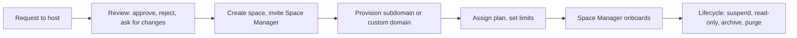

# Superadmin (platform administrator)

The platform administrator runs the installation as a whole. You have your own account and sign-in, separate from every space's staff. This guide covers the platform console. Server-side work (installing, updating, environment keys) belongs to the host operator; see [Install and update](../install-and-update.md) and the [operator manual](../operator-manual.md).

## The screens you see

| Menu entry | What it holds |
| --- | --- |
| **Platform dashboard** | Space counts, delivery and usage totals, **Problems**, **Platform overview**, **Platform insights** |
| **Spaces** | **Health**, **Onboarding**, **Announcements**; plans and limits on a hosted platform |
| **Inbox across spaces** | Notices that reach you from every space |
| **People & access** | **Account** lookup, and each space's **Staff & Space Managers** |
| **Platform security** | **IP access** rules, each space's **security locks**, the cross-space **Audit log** |
| **Data & recovery** | **Backup & restore**, **Offsite copies**, **Restore drills**, **Self-host moves** |
| **Platform analytics** | A platform-wide Metabase or Grafana connection |
| **Platform settings** | Email, sign-in providers, messaging, mobile apps, chat templates, Stripe Connect, version |
| **Usage & limits** | Each space's usage against its plan on a hosted platform |

## How do I sign in?

1. Open `/admin?context=platform`. The page says **Platform console**.
2. Enter your username or email and password, then your authenticator code if set.
3. On the very first sign-in, change the generated password.

Forgot the password? **Forgot password?** works if the platform's email is configured. If email is down, the host operator can reset the password or authenticator from the server.

## How do I work inside a space?

1. Use **Find a makerspace** and pick one under **Your makerspaces**.
2. A banner says you are acting as the platform superadmin and that every change is audited in that space.
3. Use any screen as the Space Manager would. **Switch makerspace** moves you on.

**Personal data is masked** (names, emails, phone numbers) until you open a window: press **Open PII access** on the banner, type a reason of 10 to 300 characters, and press **Open for 30 minutes**. **Close now** ends it early. The space's managers can read every window and its reason under **Recent platform access**. Personal-data exports are refused without an open window.

## How do I create a space and a Space Manager?

1. Press **Create makerspace**. On a multi-organization site it needs an owning organization: pick one or create it.
2. Open **Users** (shown as **Staff & roles**), pick the space, and use **Grant roles** for an existing account or **Invite by email**.
3. Tick **Space Manager** on its own (it cannot be combined) and press **Save roles**.

Only you give or remove Space Manager. A space always keeps at least one active Space Manager, and nobody manages their own roles.

## Hosted spaces versus your own

Space Works has one deployment mode: you run it. If you also run spaces for others, switch on **Hosting other makerspaces** under **Platform**, **Spaces**. It is a setting, not a different product. Switching it off hides everything below and deletes nothing.

Each space is either:

- an **Own space**: no plan, no limits, no hosting billing, or
- a **Hosted space**: a plan, limits, an optional trial and recorded hosting billing can apply.

You choose per space, and one install can mix both.

### Plans and limits

The effective limit is the first that applies: the **space override**, then the **plan**, then the built-in fair-use default (only when a platform domain is set), otherwise unlimited.

1. Open **Spaces**, **Plans** to create, edit and archive plans. A plan can set any numeric limit, monthly allowances (email, SMS, WhatsApp, events) and the modules it allows.
2. Assign a plan from a space's **Manage** menu.
3. To override one limit, open the space under **Spaces**, **Health**, **Details**, **Limits**. Each row shows the effective value, where it comes from and current usage. `-1` means unlimited; blank follows the plan.

Limits cover products, assets, machines, events, bookings, staff, members, storage, monthly print requests, daily email and each notification channel, signed webhooks, API clients, machine-service requests, data exports and guest and day passes per day. A person who hits a limit sees which one. Modules a limit gates, such as events or email, are installed by you until the limit is lifted.

> **Note** Overdue hosting invoices restrict a space (read-only after the grace period) only while **Auto-enforce** is on. Trials end read-only.

### Requests to host

1. Open **Spaces**, **Onboarding**. Each request can be accepted, rejected (the reason is emailed) or sent back for changes.
2. On an accepted request press **Create makerspace**, confirm your identity, and complete the pre-filled form. Nothing is created automatically.
3. In the space's detail, **Provision subdomain** assigns `<label>.<platform domain>`. A space owner may instead request a custom domain.

## How do I pause, archive or close a space?

Open **Spaces**, **Health**, then a space's **Manage** menu.

- **Suspend** pauses ordinary service, with a reason; **Unblock** restores it.
- **Make read-only** keeps permitted reads and blocks changes; **Lift read-only** removes it.
- **Transfer ownership** changes who is responsible.
- **Schedule archive & purge** plans a closure; **Archive now** archives immediately; **Cancel schedule** stops a plan.
- An archived space offers **Unarchive**, **Schedule purge** and **Purge**.

> **Warning** Purging permanently removes a space's data. You type the exact space slug to confirm. Export what you need first. Payment records are always kept.

You can act in a paused or read-only space; the console warns first and the action is audited.

## How do I back up and restore?

Open **Data & recovery**, **Backup & restore**. Under **What to back up or restore** choose **Whole platform** or one space.

- **One space:** press **Back up now** or pick a restore point, press **Restore...**, review the **Preview**, type the space's short name, confirm with your password and watch **Restore progress**. A safety backup is taken first.
- **Whole platform:** **Create full deployment archive**; set **Daily full backup** and retention; to restore press **Restore from a backup...**, choose **Roll back in place** or **Disaster recovery**, type `deployment` and press **Review restore**. The final step runs on the server.
- **Offsite copies** sends archives to S3-compatible buckets; **Restore drills** proves an archive restores in a throwaway database; **Self-host moves** handles a space leaving for its own server.

Keep the platform archive identity off the server. Details: [Backup and restore](../backup-and-restore.md).

## How do I keep the platform secure?

- **Security locks.** Choose a space, open **Security**, change a setting (you confirm your identity each time), add an optional note and press **Lock at current value** or **Lock on**. A locked setting can only be made stricter by the Space Manager. **Remove platform lock** undoes it. Two-step sign-in for staff is a platform rule nobody can switch off.
- **IP access.** Under **Platform security**, add allow and deny rules and review automatic blocks.
- **Accounts.** Under **People & access**, **Account**, disable or re-enable an account and reset two-step sign-in.
- **Audit log.** Under **Platform security**, read every recorded action across spaces.
- **Sign-in providers.** Under **Platform settings**, **Sign-in providers**: Google, Apple and GitHub for members, and your own single sign-on. Secrets stay hidden; leave a field blank to keep it.

## What is `/control/`?

`/control/` is the back office for rarer, heavier tools: archive and purge, purging a feature's data with a preview, backup keys, self-host move and hosting requests, login methods, platform email/SMS/push, scheduled task runs, IP rules, and per-space encryption keys. It is off the public address by default. Ask the host operator to open it through the proxy or an SSH tunnel, sign in with your account, and complete two-step sign-in. See [Self-hosting](../self-hosting.md#reaching-the-control-plane).

## What stays with you and not the Space Manager?

Space Managers switch areas on and off, and switching off always keeps data. You alone: install a module that carries a usage limit on a hosted plan, give or remove Space Manager, restrict or restore a borrower, and delete data. Purging a feature's switched-off maintenance, To-Buy or warranty data is done from `/control/` with a preview and a typed confirmation; a whole module's data is purged by the host operator on the server.

## Related

[Self-hosting](../self-hosting.md) · [Platform monitoring](../platform-monitoring.md) · [Tutorial: Set up your first makerspace](../tutorials/first-makerspace.md) · [Logging and audit](../logging-and-audit.md)
