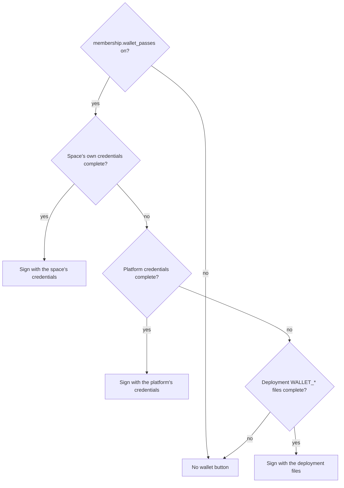

# Apple and Google Wallet passes

Wallet passes put a member, programme or event card (and, with guest passes on, a guest pass) into the
holder's Apple Wallet or Google Wallet. They are governed by the `membership.wallet_passes` switch
([modules](MODULES.md)); `events.wallet_passes` does the same for event ID cards. With the switch off, or
with no credentials, no wallet button is shown anywhere.

## What it does

- A card's wallet pass shows the space name and logo, holder name, card number, plan / programme / event,
  valid-until date and a QR. **Never** a photo, e-mail, phone number or birth date.
- Member and programme cards are **updatable**: when the card changes, Apple devices are told by push
  (APNs) and Google objects are patched through the Wallet API. A failed push never blocks the card.
- Guest passes are **static** (a dated permit): the pass carries its own expiry and no update service.
  Revocation lives on the server, because the QR is a revocable token (`gp1.<id>.<hmac>`) that staff
  resolve against the live row. A revoked, expired or converted pass answers "not valid" at once, even if the
  copy is still in someone's wallet.

## Whose credentials sign the pass

Resolved independently for Apple and Google, first match wins:

1. the **space's own** credentials (Space Manager, in **Settings -> Wallet passes**; needs the capability on);
2. the **platform's** credentials (superadmin, in **Platform settings -> Wallet passes**), so one set can serve
   every space that has none of its own;
3. the deployment files named by the `WALLET_*` environment settings (`WALLET_APPLE_PASS_TYPE_ID`,
   `WALLET_APPLE_TEAM_ID`, `WALLET_APPLE_CERT_FILE`, `WALLET_APPLE_KEY_FILE`, `WALLET_APPLE_WWDR_FILE`,
   `WALLET_GOOGLE_ISSUER_ID`, `WALLET_GOOGLE_SERVICE_ACCOUNT_FILE`).

If none is complete, that platform is off for that space and its button is hidden. Saved credentials are
encrypted at rest, write-only (the API never returns them), audited by field name only, and never exported
or moved with a space.



## Getting Apple credentials (Pass Type ID certificate)

You need a paid Apple Developer Program membership.

1. Sign in at developer.apple.com -> **Certificates, Identifiers & Profiles** -> **Identifiers**.
2. Add a **Pass Type IDs** identifier, for example `pass.org.yourspace.card`. Note your **Team ID**
   (Membership details; ten characters).
3. Open the identifier -> **Create Certificate**. Upload a certificate signing request made in Keychain
   Access (macOS) or with OpenSSL: `openssl req -new -newkey rsa:2048 -nodes -keyout pass.key -out pass.csr`.
4. Download the issued `.cer`. Either import it into Keychain Access with its key and **export a `.p12`**
   (choose a password), or convert it: `openssl x509 -inform DER -in pass.cer -out pass.pem`.
5. Download **Apple WWDR G4** from Apple's certificate authority page
   (https://www.apple.com/certificateauthority/) and convert it to PEM:
   `openssl x509 -inform DER -in AppleWWDRCAG4.cer -out wwdr.pem`.
6. In SpaceWorks paste/upload: Pass Type ID, Team ID, the `.p12` and its password (or the certificate PEM
   plus the private-key PEM), and the WWDR PEM.

SpaceWorks checks the upload before saving: the key must belong to the certificate, the certificate must not
be expired, and the Pass Type ID and Team ID must match the certificate's UID and OU. A mismatch fails here
with a field-level message instead of as a silent "invalid pass" on a phone. Apple Pass Type ID certificates
last about a year: the settings screen warns 30 days before expiry. Renew before it lapses or new passes stop
being accepted.

## Getting Google credentials

1. Open the Google Wallet Business console (pay.google.com/business/console) and create an **issuer
   account**; copy the **Issuer ID** (a long number).
2. In Google Cloud Console create (or pick) a project, enable the **Google Wallet API**, and create a
   **service account**. Create a **JSON key** for it.
3. In the Wallet console -> **Users**, add the service account's e-mail as a user of the issuer with
   permission to manage passes.
4. In SpaceWorks paste the Issuer ID and the whole service-account JSON. Optionally change the class prefix
   (default `spaceworks_card`). Until Google approves your issuer for production, passes can be saved only by
   test users you list in the console; that is a Google setting, not a SpaceWorks one.

## Verifying it works (no accounts needed)

`scripts/dev/verify_wallet_offline.py` generates a throw-away CA, Pass Type ID certificate and service-account
key, runs the real parser and pass builders, and then checks the output independently: unzips the `.pkpass`,
re-computes every SHA-1 in `manifest.json`, verifies the detached PKCS#7 signature against the generated
chain with `openssl smime -verify` (and shows a tampered manifest fails), checks `pass.json` for PII, and
decodes the Google save-link JWT and verifies its RS256 signature with the public key and its claims
(`iss`, `aud: google`, `typ: savetowallet`, `origins`, object and class ids).

```
python scripts/dev/verify_wallet_offline.py                    # host venv with backend/requirements.txt
docker compose cp scripts/dev/verify_wallet_offline.py backend:/tmp/verify_wallet_offline.py
docker compose exec backend python /tmp/verify_wallet_offline.py   # in the dev stack
```

Exit code 0 means every check passed. What it cannot prove: that Apple's Wallet app or Google's servers
accept your real certificate. After saving real credentials, open a member card on an iPhone and tap **Add to
Apple Wallet**; for Google tap **Save to Google Wallet** with a test user.

## What holders see

My passes -> the card -> **Add to Apple Wallet** / **Save to Google Wallet**, shown only for platforms that
have credentials. Guest-pass holders get the same buttons for a pass that is still usable.

## Revocation and changes

- A revoked or restricted holder's card is **voided** (Apple) or set to **INACTIVE** (Google) on the next
  update push; the QR stops working at once because staff resolve it on the server.
- Guest passes cannot be updated; revoke them in SpaceWorks. The wallet copy keeps its printed expiry but is
  no longer accepted.
- **`reissue_needed`:** changing the Apple Pass Type ID makes passes already in wallets unverifiable
  (Apple ties a pass to its Pass Type ID). The save response carries `reissue_needed: true`; tell holders to
  re-add their passes from My passes. Rotating the certificate for the *same* Pass Type ID does not need this.
- Turning the module off stops updates and hides buttons; saved credentials are kept.

## Troubleshooting

| Symptom | Likely cause |
| --- | --- |
| "The Pass Type ID does not match the certificate" | The certificate's UID differs from what you typed; copy it from the identifier. |
| "The Team ID does not match" | Use the ten-character Team ID in Membership, not the Pass Type ID prefix guess. |
| "The private key does not belong to this certificate" | The key is from a different CSR; re-export the `.p12` from the same Keychain item. |
| Apple says the pass cannot be added | WWDR is the wrong generation or expired (use G4); certificate expired; Pass Type ID changed after issuing. |
| Passes do not refresh on iPhones | The API must be reachable over HTTPS from the phone (`PUBLIC_API_BASE_URL`); the APNs call uses the same certificate. |
| Google "Save" shows an error | Service account is not a user of the issuer, the Wallet API is not enabled, or the issuer is still in demo mode. |
| No button appears | Capability off, no complete credentials, or (guest passes) payment not cleared / pass not live. |
